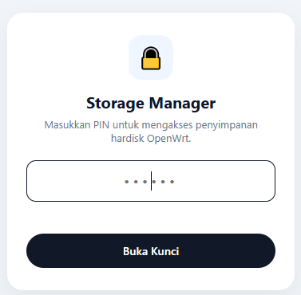
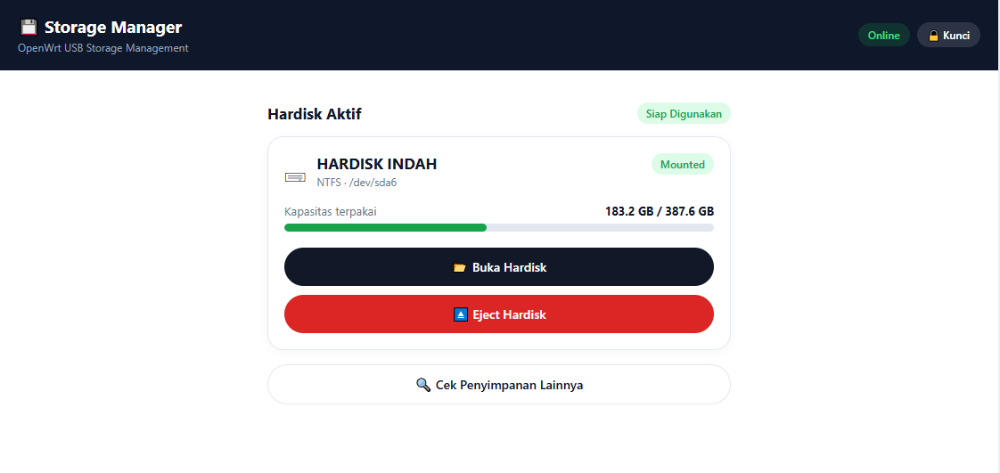
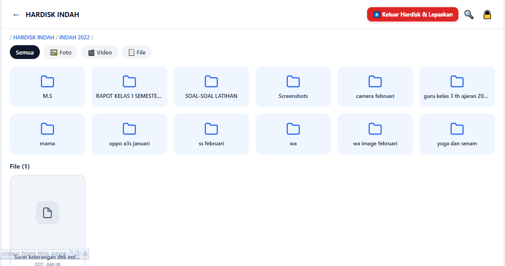

# 💾 Web Hardisk SSD — OpenWrt USB Storage Manager


Aplikasi web file manager super ringan untuk mengakses dan mengelola Hardisk / SSD / Flashdisk USB langsung dari browser HP atau laptop pada **STB OpenWrt**. Tanpa perlu repot *mount/unmount* manual lewat LuCI, tanpa instalasi aplikasi tambahan di HP, dan cukup akses lewat alamat domain lokal pilihan Anda sendiri.

---

## ✨ Fitur Utama

- **🔌 Auto-Mount Otomatis:** Colok hardisk USB ke STB, otomatis langsung terbaca dan siap dibuka (mendukung NTFS, FAT32, exFAT, dan EXT4 sesuai driver OpenWrt).
- **🔒 Keamanan Kunci PIN:** Wajib memasukkan PIN setiap kali membuka atau keluar dari halaman. Terpisah sepenuhnya dari password admin LuCI.
- **🌐 Domain Lokal Kustom:** Bisa diakses lewat alamat domain lokal sesuka hati (contoh: `http://webhardisk.com`) tanpa perlu membeli domain asli, sementara `192.168.1.1` tetap mengarah ke LuCI.
- **⏏️ Safe Eject dengan Konfirmasi:** Tombol lepas hardisk dilengkapi kotak konfirmasi untuk mencegah kerusakan data (*corrupt*) sebelum kabel USB dicabut.
- **🖼️ Preview Foto, Video & File:**
  - Pemilah kategori cepat (**Semua, Foto, Video, File**) dan kolom pencarian.
  - Preview gambar & cuplikan video langsung di daftar file.
  - Mode **Perbesar / Fullscreen** dengan navigasi geser kiri/kanan (*swipe* di HP atau tombol panah di keyboard).
- **☑️ Mode Pilih Banyak (*Long Press*):** Tahan klik pada file, foto, video, atau folder untuk menandai beberapa item sekaligus, lalu **Download** atau **Hapus** (wajib konfirmasi).
- **📱 Responsif:** Tampilan otomatis menyesuaikan layar HP, tablet, maupun laptop.

---

## 📸 Tampilan Aplikasi

| Layar Kunci PIN | Halaman Depan Hardisk | File Manager & Preview |
| :---: | :---: | :---: |
|  |  |  |

---

## 🚀 Cara Instalasi

Pastikan STB OpenWrt Anda terhubung ke internet dan sudah memiliki paket dasar `blkid` (biasanya sudah termasuk di `block-mount`) serta driver format hardisk yang digunakan (misalnya `ntfs-3g` untuk NTFS atau `kmod-fs-exfat` untuk exFAT).

1. Masuk ke terminal STB OpenWrt melalui **SSH** atau menu **Services → Terminal (TTYD)** di LuCI.
2. Salin dan jalankan 1 baris perintah berikut:

```sh
wget -qO /tmp/install.sh [https://raw.githubusercontent.com/ASHTERSAI/Web-Hardisk-SSD/main/install.sh](https://raw.githubusercontent.com/ASHTERSAI/Web-Hardisk-SSD/main/install.sh) && sh /tmp/install.sh && rm -f /tmp/install.sh
```

3. Ikuti 2 langkah konfirmasi yang muncul di terminal:
   - **Masukkan alamat web hardisk** (contoh: `webhardisk.com` — bebas ketik apa saja berakhiran `.com`, tidak perlu beli domain).
   - **Masukkan PIN akses** (contoh: `123456`).
4. Tunggu hingga muncul pesan **`INSTALASI SELESAI!`**.

> **Catatan Pengguna OpenClash:** Setelah instalasi selesai, jalankan `/etc/init.d/openclash restart` jika koneksi internet sempat terputus akibat restart `dnsmasq`.

---

## 📖 Cara Pemakaian

1. **Hubungkan Perangkat:** Pastikan HP atau laptop terhubung ke WiFi STB OpenWrt. *(Jika domain lokal tidak terbuka di HP, matikan sementara fitur **DNS Pribadi / Private DNS** di pengaturan HP).*
2. **Buka Aplikasi:** Ketik alamat domain lokal yang Anda buat tadi di browser (misalnya `http://webhardisk.com`), atau melalui alamat IP `http://192.168.1.1/webssd`.
3. **Login PIN:** Masukkan PIN Anda untuk membuka halaman depan hardisk aktif.
4. **Kelola File:**
   - Klik **📂 Buka Hardisk** untuk menjelajah folder, mencari file, atau memilah Foto/Video/File.
   - **Ketuk 1x** pada file untuk membuka menu *Tampilkan File Asli*, *Download*, atau *Hapus*.
   - **Tahan klik (*Long Press*)** pada file atau folder untuk menandai banyak item sekaligus.
5. **Lepas Hardisk dengan Aman:** Sebelum mencabut kabel USB dari STB, klik **⏏️ Keluar Hardisk & Lepaskan** di bar atas, lalu tekan tombol merah **⏏️ Eject Hardisk** di halaman depan dan konfirmasi **Ya, Lepas**.

---

## 🗑️ Cara Hapus Semua Proyek (Uninstall)

Jika Anda ingin menghapus seluruh aplikasi, script auto-mount, domain lokal, dan mengembalikan halaman utama OpenWrt ke LuCI seperti semula, jalankan perintah ini di terminal OpenWrt:

```sh
wget -qO /tmp/uninstall.sh [https://raw.githubusercontent.com/ASHTERSAI/Web-Hardisk-SSD/main/uninstall.sh](https://raw.githubusercontent.com/ASHTERSAI/Web-Hardisk-SSD/main/uninstall.sh) && sh /tmp/uninstall.sh && rm -f /tmp/uninstall.sh
```

Ketik **`y`** lalu tekan Enter saat diminta konfirmasi.

---

## 📂 Struktur File Repository

- `index.html` — Antarmuka Web Storage Manager & File Browser.
- `storage-api` — Backend Shell CGI OpenWrt (scan, mount, unmount, list, stream, delete, PIN).
- `99-usb-automount` — Script hotplug OpenWrt untuk auto-mount USB otomatis.
- `install.sh` — Script instalasi interaktif.
- `uninstall.sh` — Script penghapusan bersih.
